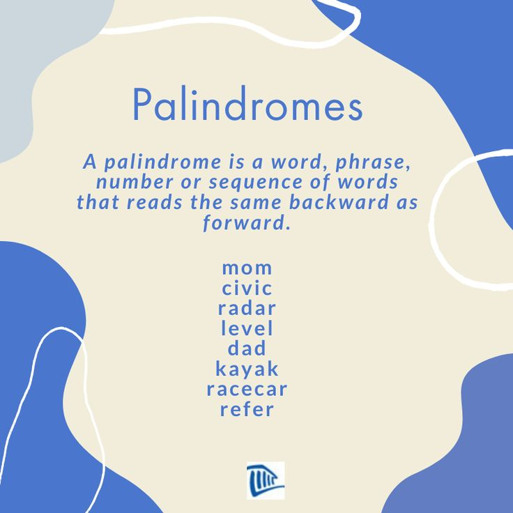

# Outline
- Check if string is palindrome using recursion
- Palindrome - word spelt same forwards and backwards e.g. racecar

# Approach
- string theory 
- function theory
- recursion
- iteration  
- validation

# Algorithm steps

